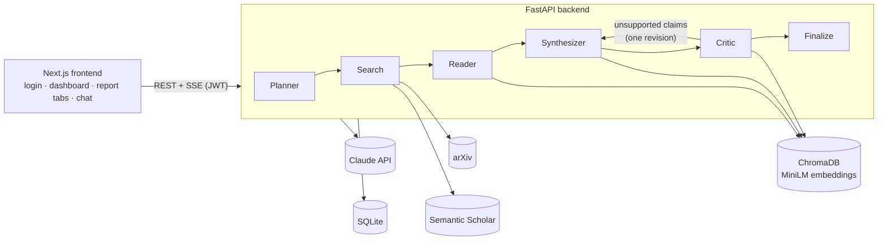
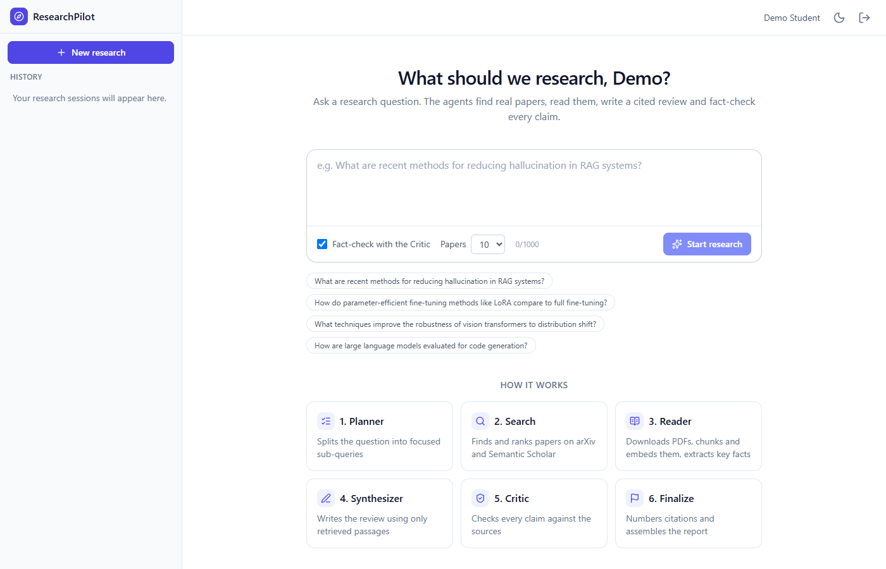
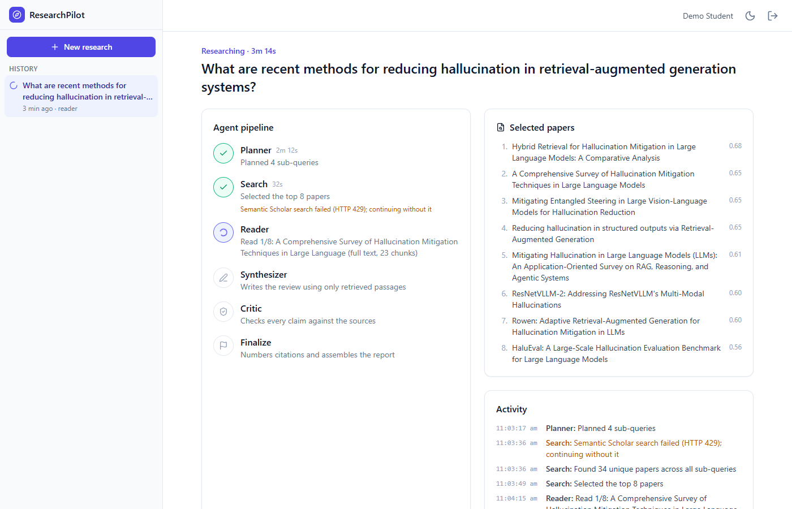
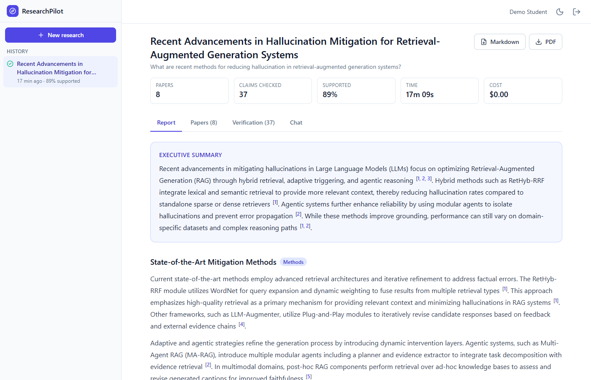
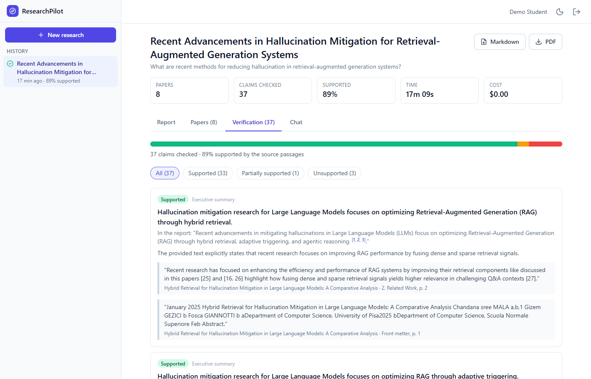
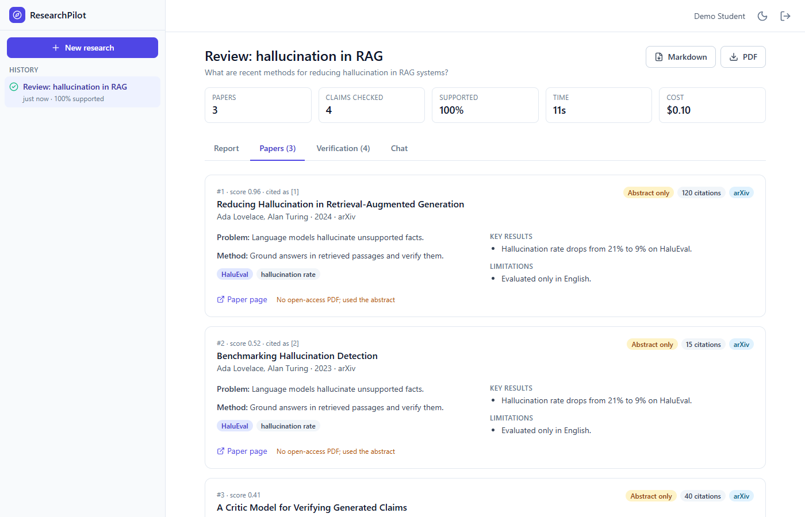
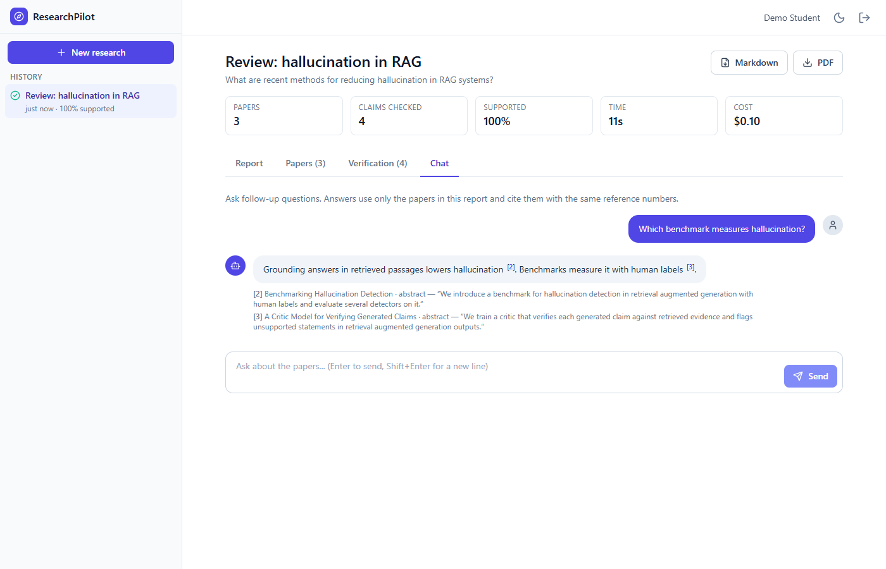
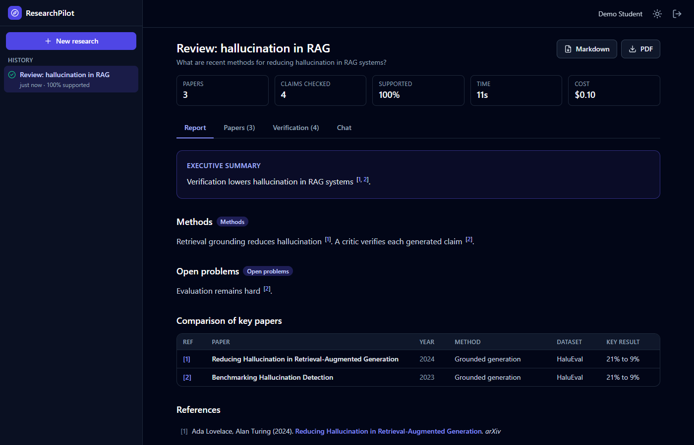
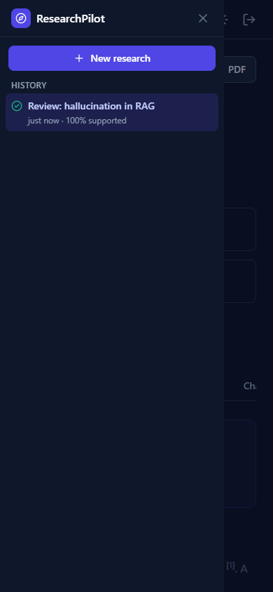

# ResearchPilot – Multi-Agent Research Copilot

Ask a research question and get back a **structured, cited literature review**. A team of AI
agents searches real papers on arXiv and Semantic Scholar, reads them, writes the review using
only what the papers say, and then **fact-checks every claim** against the source text before
you see it.

- **Five cooperating agents** orchestrated with LangGraph: Planner → Search → Reader → Synthesizer → Critic.
- **Grounded citations.** Every sentence cites the exact passage it relies on, and a *Verification*
  panel shows each claim as *Supported / Partially supported / Unsupported* next to its evidence.
- **Live progress.** Each agent step streams to the browser (Server-Sent Events).
- **Follow-up chat** over the same papers (RAG), plus **Markdown and PDF export** and a saved history.
- **Built-in evaluation** with an **ablation study** that measures what the Critic agent adds.

> Detailed diagrams and module descriptions: [docs/architecture.md](docs/architecture.md) ·
> Deployment: [docs/deployment.md](docs/deployment.md)

## Architecture



| Agent | What it does |
|---|---|
| **Planner** | Splits the question into 3–5 focused sub-queries with search keywords. |
| **Search** | Queries arXiv and Semantic Scholar, merges duplicates, ranks by relevance (embedding similarity), citations and recency, keeps the top N. |
| **Reader** | Downloads each PDF (or falls back to the abstract), extracts text with PyMuPDF, splits it into ~800-token chunks with 100 tokens of overlap, embeds them into ChromaDB, and extracts problem / method / datasets / metrics / results / limitations as validated JSON. |
| **Synthesizer** | Writes the themed review and comparison table **only from retrieved passages**, citing each passage as `[E#]`. |
| **Critic** | Splits the draft into atomic claims, checks each against the evidence, and sends unsupported claims back for **one** revision. Claims still unsupported are removed (or flagged). |

## Screenshots

> These were captured from an end-to-end browser test of the real UI running against the **offline demo pipeline**
> (mocked language model), so the report text is sample data. Replace them with screenshots of a real run for your report.

| Dashboard | Live agent progress |
|---|---|
|  |  |
| **Report with citations** | **Verification panel** |
|  |  |
| **Papers with extracted summaries** | **Follow-up chat** |
|  |  |
| **Dark mode** | **Mobile** |
|  |  |

## Tech stack

| Layer | Technology |
|---|---|
| Agents | LangGraph 1.2 (state machine with a conditional Critic → Synthesizer revision loop) |
| LLM | **Google Gemini (free tier)** or **Anthropic Claude**, chosen by `LLM_MODEL`, via the official `google-genai` / `anthropic` SDKs. All calls go through `backend/app/llm.py`: Pydantic-validated JSON output, retries, rate limiting, token and cost tracking. |
| Backend | Python 3.11, FastAPI, Pydantic v2, SQLAlchemy 2 + SQLite, JWT auth (python-jose, passlib/bcrypt), SSE (sse-starlette) |
| Retrieval | ChromaDB (persistent), sentence-transformers `all-MiniLM-L6-v2` on CPU (windowed mean pooling for 800-token chunks), PyMuPDF |
| Frontend | Next.js 14 (App Router), React 18, TypeScript, Tailwind CSS, dark mode |
| Export | Markdown and PDF (ReportLab) |
| Ops | Docker, docker-compose; Vercel (frontend) + Railway/Render (backend) |
| Quality | 338 backend tests (pytest), 30 frontend tests (Vitest), ESLint, strict TypeScript |

## Project structure

```
researchpilot/
├── backend/
│   ├── app/
│   │   ├── main.py            FastAPI app factory, start-up/shutdown
│   │   ├── config.py          all settings, read from .env
│   │   ├── llm.py             the only module that calls Claude
│   │   ├── db.py, models.py   SQLAlchemy engine and tables
│   │   ├── schemas.py         Pydantic request/response and domain models
│   │   ├── auth.py            bcrypt + JWT
│   │   ├── deps.py            shared FastAPI dependencies
│   │   ├── agents/            state, planner, search, reader, synthesizer, critic, finalize, graph (+ CLI)
│   │   ├── services/          arxiv/semantic-scholar clients, pdf_parser, vector_store, run_manager,
│   │   │                      session_store, chat_service, export, http_utils
│   │   └── routes/            health, auth, research (SSE), reports (export), chat
│   ├── tests/                 pytest suite (offline; live tests behind RP_RUN_INTEGRATION=1)
│   ├── requirements.txt, requirements-dev.txt, pytest.ini, Dockerfile
├── frontend/
│   ├── src/app/               pages: login, register, dashboard, research/[id]
│   ├── src/components/        app shell, history sidebar, live progress, report tabs, chat
│   ├── src/lib/               API client, SSE parser, progress/citation helpers (+ Vitest tests)
│   └── Dockerfile
├── eval/                      25 benchmark questions, judges, paired Critic ablation, run_eval CLI
├── docs/                      architecture.md, deployment.md, screenshots/, report/viva material
├── docker-compose.yml, render.yaml, .env.example
└── README.md
```

## Quick start

You need **one** language-model key: a **free Google Gemini key** (<https://aistudio.google.com/apikey>,
Google account, no card) or a paid Anthropic key (<https://console.anthropic.com>). A free **Semantic Scholar API key** is
strongly recommended (<https://www.semanticscholar.org/product/api#api-key-form>).

### Option A – Docker (one command)

Requires Docker Desktop.

```powershell
cd researchpilot
Copy-Item .env.example .env        # macOS/Linux: cp .env.example .env
# edit .env: set GEMINI_API_KEY (free) or ANTHROPIC_API_KEY, and JWT_SECRET_KEY
docker compose up --build
```

Open <http://localhost:3000>, create an account and ask a question. The first build takes 5–10 minutes
because it downloads CPU-only PyTorch and the embedding model.

### Option B – Local development (Windows PowerShell)

Requires Python 3.11 and Node.js 18.18+ (tested with Node 22).

```powershell
# 1. Configuration
cd researchpilot
Copy-Item .env.example .env
python -c "import secrets; print(secrets.token_urlsafe(48))"   # paste as JWT_SECRET_KEY in .env
# also set GEMINI_API_KEY (free, default model) or ANTHROPIC_API_KEY in .env

# 2. Backend (terminal 1)
cd backend
py -3.11 -m venv .venv
.\.venv\Scripts\Activate.ps1          # if blocked: Set-ExecutionPolicy -Scope CurrentUser RemoteSigned
pip install -r requirements-dev.txt
uvicorn app.main:app --reload --reload-dir app

# 3. Frontend (terminal 2)
cd frontend
Copy-Item .env.example .env.local
npm install
npm run dev
```

Open <http://localhost:3000>. The API docs are at <http://localhost:8000/docs>.
On macOS/Linux use `python3.11 -m venv .venv`, `source .venv/bin/activate` and `cp` instead of `Copy-Item`.

## Configuration

All settings live in `.env` (see [.env.example](.env.example) for every option with an explanation). The most important:

| Variable | Default | Meaning |
|---|---|---|
| `GEMINI_API_KEY` / `ANTHROPIC_API_KEY` | – | Key for the provider of `LLM_MODEL`; required for research, chat and evaluation. |
| `LLM_MODEL` | `gemini-3.8-flash` (in `.env.example`) | Model used by every agent. `gemini-*` uses Google's free tier; `claude-*` uses paid Anthropic models (e.g. `claude-opus-5`, or `claude-sonnet-5` at ~40% of its price). |
| `LLM_REQUESTS_PER_MINUTE` | `8` (in `.env.example`) | Spaces out model calls to stay under free-tier per-minute limits (`0` = unlimited). |
| `LLM_EFFORT` | `high` | Reasoning effort (`low` … `max`); simple extraction calls automatically use at most `medium`. |
| `JWT_SECRET_KEY` | random per process | Set it, or logins reset on every restart. Required in production. |
| `SEMANTIC_SCHOLAR_API_KEY` | – | Without it Semantic Scholar is often rate-limited, and searches fall back to arXiv only. |
| `TOP_N_PAPERS` | `10` | Papers kept after ranking. |
| `CHUNK_SIZE_TOKENS` / `CHUNK_OVERLAP_TOKENS` | `800` / `100` | Chunking of paper text. |
| `ENABLE_CRITIC` | `true` | Turn the Critic off (ablation). Also selectable per run in the UI. |
| `MAX_REVISIONS` | `1` | Critic → Synthesizer revision passes. |
| `UNSUPPORTED_CLAIM_POLICY` | `remove` | What happens to claims still unsupported: `remove` or `flag`. |
| `ALLOW_REGISTRATION` | `true` | Set to `false` on a public deployment once your account exists. |

## Using it

- **Web app:** ask a question on the dashboard. Watch the agents work live, then read the report in four
  tabs: **Report**, **Papers**, **Verification** and **Chat**. Export it with the Markdown and PDF buttons.
- **Command line:** run one question without the web app (from `backend/`):
  ```powershell
  python -m app.agents.graph "What are recent methods for reducing hallucination in RAG systems?"
  python -m app.agents.graph "..." --no-critic --top-n 6 --print
  ```
  Reports are saved as Markdown and JSON in `backend/data/runs/`.
- **REST API:** interactive documentation at `/docs`; the endpoints are listed in [docs/architecture.md](docs/architecture.md#http-api).

## Evaluation and the Critic ablation

`eval/` contains 25 benchmark questions across ML/NLP topics and a runner that measures:

| Metric | How it is measured |
|---|---|
| **Citation accuracy** | For every (sentence, cited passage) pair, an LLM judge decides whether the passage supports the sentence. |
| **Faithfulness** | The final report is split into atomic claims, each verified against the sources (the Critic's procedure, applied equally to both arms). |
| **Answer relevance** | An LLM judge scores 1–5 how well the review answers the question. |
| **Latency and cost** | Per stage and in total, from the pipeline's own metering. |

**Ablation design:** each question runs the pipeline **once**. The Synthesizer's first draft, finalised
*without* verification, is the "without Critic" arm; the verified and revised report is the "with Critic" arm.
Both arms share the same papers and evidence, so the difference isolates the Critic's effect. Results report
paired differences with 95% bootstrap confidence intervals.

```powershell
cd researchpilot
backend\.venv\Scripts\python -m eval.run_eval --limit 2 --yes          # quick trial on 2 questions
backend\.venv\Scripts\python -m eval.run_eval --yes                    # all 25 questions
backend\.venv\Scripts\python -m eval.run_eval --resume --yes           # continue after an interruption
backend\.venv\Scripts\python -m eval.run_eval --pipeline-model claude-sonnet-5 --judge-model claude-opus-5 --yes
backend\.venv\Scripts\python -m eval.deliverables                      # resume bullets + results paragraph from your numbers
```

Results are written to `eval/results.json` (all data) and `eval/results.md` (summary tables). Every question
costs one full pipeline run plus judging, so start with `--limit 2` and check the cost it reports.

## Testing

```powershell
cd backend;  pytest                                              # 338 offline tests
cd backend;  $env:RP_RUN_INTEGRATION="1"; pytest -m integration  # live arXiv / Semantic Scholar / PDF / model tests
cd frontend; npm test; npm run lint; npm run typecheck; npm run build
```

The offline tests replace Claude and the search APIs with fakes, including a deliberately planted false claim.
That lets them check the whole pipeline end to end: the Critic catching the claim, the revision removing it,
and the API streaming it all.

## Cost and rate limits

- A research run makes roughly 15–25 Claude calls: planning, one extraction per paper, drafting, claim
  splitting and verification (twice if a revision happens). The terminal summary, the report header and the
  evaluation all show the **actual** cost; check it on a first run before running the full evaluation.
- New Anthropic accounts have low rate limits. If runs fail with "temporarily unavailable", set
  `LLM_MAX_CONCURRENCY=1` and `MAX_CONCURRENT_RUNS=1`.

## Troubleshooting (local)

| Problem | Fix |
|---|---|
| `Activate.ps1 cannot be loaded` | `Set-ExecutionPolicy -Scope CurrentUser RemoteSigned`, then try again. |
| 503 "The language model is not configured" | Put `GEMINI_API_KEY` (or `ANTHROPIC_API_KEY` for Claude models) in `.env` (project root) and restart the backend. |
| "Gemini free-tier rate limit reached" | The free quota (per minute or per day) is used up. Wait, lower `LLM_REQUESTS_PER_MINUTE`, or switch to `gemini-3.5-flash-lite` (larger daily quota). The evaluation can continue later with `--resume`. |
| Semantic Scholar warnings (HTTP 429) | Its shared public quota is exhausted; add `SEMANTIC_SCHOLAR_API_KEY`. arXiv results are still used. |
| Frontend says "Cannot reach the ResearchPilot server" | Start the backend, and check `NEXT_PUBLIC_API_URL` in `frontend/.env.local`. |
| Slow or odd file errors inside the project folder | The folder is inside OneDrive. Pause OneDrive syncing while developing, or move the project out of OneDrive. |

## Key design decisions

1. **Citations point to exact chunks.** The Synthesizer cites evidence labels (`[E3]`) that map to stored
   chunks. That is what makes claim verification and citation-accuracy scoring possible; readers see numbered paper
   references (`[1]`).
2. **Windowed embeddings.** MiniLM reads at most 256 word-pieces, but chunks are ~800 tokens. Each chunk is embedded
   as the average of its windows, so the whole chunk counts for retrieval.
3. **One LLM gateway.** Swapping models is a one-line `.env` change; unsupported options (such as `effort`
   on Haiku) are left out automatically, and every call is metered for the evaluation.
4. **Graceful degradation.** Rate-limited sources are skipped, broken PDFs fall back to abstracts, a failed Critic
   leaves the report marked unverified, and one failing paper never stops a run.
5. **Paired ablation.** The Critic's effect is measured on the same papers and first draft, not on two
   independent runs.
