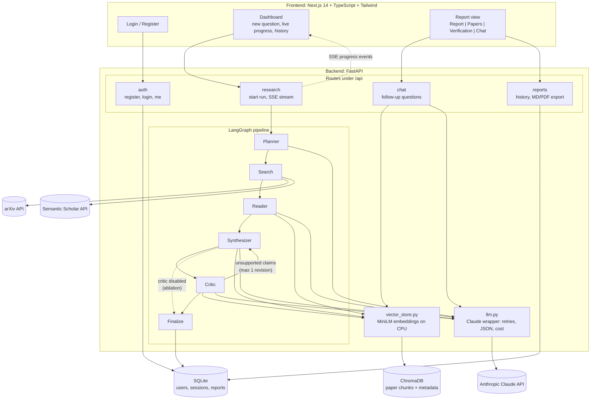
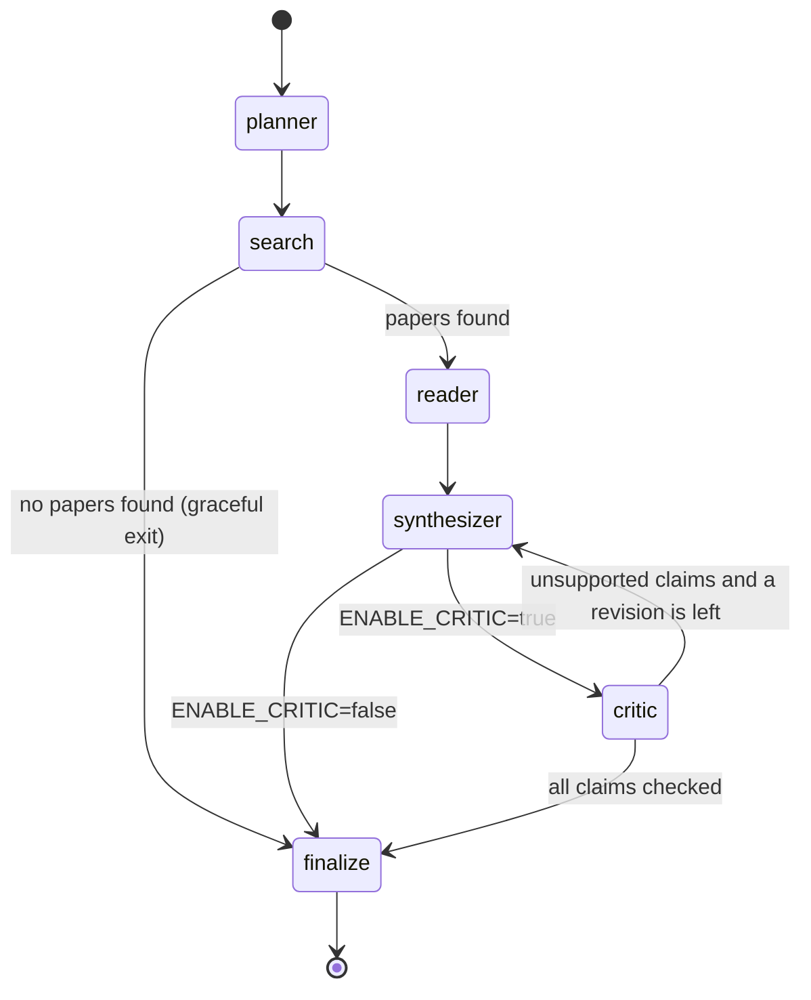
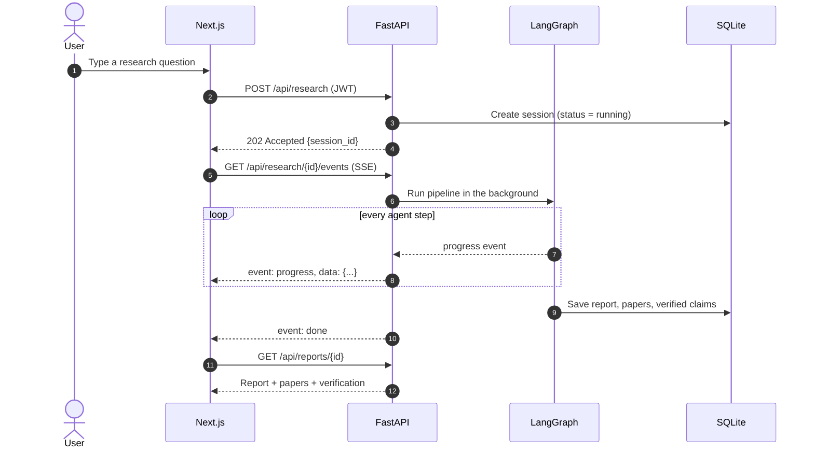

# ResearchPilot – Architecture

ResearchPilot turns a research question into a cited, fact-checked literature review.
A LangGraph pipeline of five agents searches real papers (arXiv + Semantic Scholar),
reads them, writes a review grounded only in retrieved text, and verifies every claim.

## 1. System overview

## 2. Agent state machine (LangGraph)

| Agent | Input | Output |
|---|---|---|
| **Planner** | research question | 3–5 sub-queries + search keywords (validated JSON) |
| **Search** | sub-queries | top-N papers, de-duplicated, ranked by relevance + citations + recency |
| **Reader** | papers | chunks embedded in ChromaDB + per-paper structured summary (problem, method, dataset, metrics, results, limitations) |
| **Synthesizer** | question + retrieved chunks | themed review, comparison table, inline citations `[n]` tied to chunk IDs |
| **Critic** | draft review | atomic claims labelled Supported / Partial / Unsupported with evidence snippets; triggers one revision |
| **Finalize** | verified draft | removes or flags remaining unsupported claims, stores the report |

## 3. A research run, end to end

## 4. Modules

### Backend core (`backend/app/`)
| Module | Purpose |
|---|---|
| `main.py` | FastAPI app factory: CORS, routers, start-up checks. |
| `config.py` | One typed `Settings` object loaded from `.env`; every setting lives here. |
| `logging_config.py` | One-time logging set-up (format, level, quiet third-party loggers). |
| `llm.py` | The only module that calls the language model (Google Gemini free tier or Anthropic Claude, chosen by `LLM_MODEL`): retries, rate limiting, structured JSON output, token and cost tracking. |
| `db.py` | SQLAlchemy engine, session factory and table creation (SQLite). |
| `models.py` | ORM tables: users, research sessions, reports (with claim verification as JSON), session papers, chat messages. |
| `schemas.py` | Pydantic v2 request/response and shared domain models. |
| `auth.py` | bcrypt password hashing, JWT issue/verify, `get_current_user` dependency. |

### Agents (`backend/app/agents/`)
| Module | Purpose |
|---|---|
| `state.py` | Shared typed state passed between LangGraph nodes. |
| `planner.py` | Splits the question into 3–5 focused sub-queries and keywords. |
| `search.py` | Queries arXiv and Semantic Scholar, de-duplicates, ranks, keeps the top N. |
| `reader.py` | Downloads PDFs (abstract fallback), chunks, embeds, and extracts a structured summary per paper. |
| `synthesizer.py` | Writes the literature review from retrieved chunks only, citing chunk IDs; also does the revision pass. |
| `critic.py` | Splits the draft into atomic claims, retrieves evidence, labels support, requests one revision. |
| `finalize.py` | Removes/flags claims still unsupported, turns `[E#]` evidence labels into numbered `[n]` references, renders Markdown, attaches metrics. |
| `graph.py` | Wires the nodes into a LangGraph `StateGraph`, emits progress events; CLI: `python -m app.agents.graph "question"`. |

### Services (`backend/app/services/`)
| Module | Purpose |
|---|---|
| `http_utils.py` | Shared httpx client and exponential-backoff retry for timeouts, 429s and 5xx responses. |
| `arxiv_client.py` | Async arXiv Atom API client that returns normalised `Paper` objects. |
| `semantic_scholar_client.py` | Async Semantic Scholar Graph API client with citation counts and open-access PDF links. |
| `pdf_parser.py` | PyMuPDF text extraction with page numbers and section detection, plus 800/100-token chunking. |
| `vector_store.py` | Persistent ChromaDB collection plus MiniLM embedder: add and query chunks per session. |
| `run_manager.py` | Runs pipelines in the background (queued beyond `MAX_CONCURRENT_RUNS`), keeps each run's event history and fans events out to SSE subscribers. |
| `session_store.py` | All database reads/writes for sessions, reports, papers and chat, always scoped to the owning user. |
| `chat_service.py` | Follow-up Q&A: retrieves the session's chunks, asks Claude with [E#] citations, maps them to the report's [n] numbers. |
| `export.py` | Renders a report to Markdown and PDF (ReportLab, Unicode font when available). |

`app/deps.py` holds shared FastAPI dependencies (run manager, vector store, chat LLM), which tests override with fakes.

### HTTP API
| Method & path | Purpose |
|---|---|
| `POST /api/auth/register`, `POST /api/auth/login`, `POST /api/auth/token`, `GET /api/auth/me` | Accounts and JWT tokens |
| `POST /api/research` | Start a run → `202 {session, events_url}` |
| `GET /api/research/{id}/events` | Live progress (Server-Sent Events): `running`, `progress`…, then `done` or `error` |
| `GET /api/research/{id}` | Status and current stage |
| `GET /api/reports` · `GET /api/reports/{id}` · `DELETE /api/reports/{id}` | History sidebar, full report, delete |
| `GET /api/reports/{id}/export?format=markdown\|pdf` | Download |
| `GET /api/chat/{id}` · `POST /api/chat/{id}` | Follow-up chat history / ask a question |

### Routes (`backend/app/routes/`)
| Module | Purpose |
|---|---|
| `health.py` | Liveness and configuration check (`GET /api/health`). |
| `auth.py` | Register, log in (JWT), current user. |
| `research.py` | Start a research run, stream progress over SSE, fetch the result. |
| `chat.py` | Follow-up questions answered by RAG over the session's papers. |
| `reports.py` | List, fetch and delete past sessions; export Markdown/PDF. |

### Frontend, evaluation, deployment
| Path | Purpose |
|---|---|
| `frontend/` | Next.js 14 App Router UI: auth pages, dashboard with live progress, report tabs, chat, dark mode. |
| `eval/questions.json` | 25 benchmark research questions. |
| `eval/ablation.py` | Paired Critic ablation from one pipeline run: the first draft (no Critic) vs. the verified, revised report. |
| `eval/judges.py` | LLM-as-judge citation accuracy and answer relevance; faithfulness via the Critic's verification procedure. |
| `eval/metrics.py` | Result records, paired differences with bootstrap 95% CIs, and the Markdown summary. |
| `eval/run_eval.py` | CLI `python -m eval.run_eval`: runs the benchmark, writes `results.json` + `results.md` (resumable). |
| `eval/deliverables.py` | Turns your real results into résumé bullets and a results paragraph. |
| `docker-compose.yml` | Starts backend and frontend with one command, with persistent data volumes. |
| `render.yaml`, `docs/deployment.md` | Render blueprint and the Vercel + Railway/Render deployment guide. |

## 5. Key design decisions

1. **Citations point at chunk IDs, not just papers.** Every `[n]` in the review maps to a
   specific stored chunk, so the Critic and the citation-accuracy metric can check the exact
   text a sentence relies on.
2. **Embedding window vs. chunk size.** `all-MiniLM-L6-v2` reads at most 256 word-pieces,
   but chunks are ~800 tokens so that Claude gets enough context. Each chunk is embedded
   as the mean of its ≤256-token windows, so the whole chunk counts for retrieval.
3. **One LLM gateway (`llm.py`).** Swapping models is a one-line `.env` change, and every
   call is retried the same way and metered the same way (tokens and cost), which is what
   the evaluation reports.
4. **Streaming with `fetch`, not `EventSource`.** The browser `EventSource` API cannot send an
   `Authorization` header, so the frontend reads the SSE stream through `fetch`.
5. **Critic as a switch.** `ENABLE_CRITIC` turns the verification loop on or off, so the
   ablation study runs the same code path with one flag changed.
6. **Local-first storage.** SQLite and ChromaDB both live under `DATA_DIR`. Nothing needs a
   database server, it all runs on an 8–16 GB laptop, and Docker needs only one volume.
